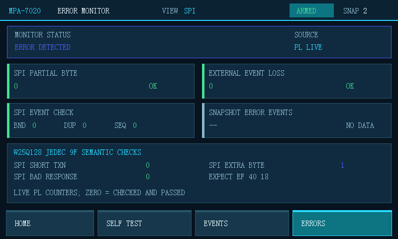

# SPI error-event closure, 2026-10-13

## Scope

This run verifies the merged member-A PL detector and member-B PS/UI error
model against the independent STM32 truth-node firmware on COM47.  The FPGA
repository does not carry a duplicate STM32 firmware tree; the authoritative
STM32 project remains `D:\RobotMaster\Project\FPGAPrj`.

The active JEDEC rule applies only to command `0x9F`: exactly four captured
bytes are required, with MOSI byte 0 equal to `9F` and MISO bytes 1..3 equal
to `EF 40 18`.

## Build and offline verification

- PS host unit tests: 7/7 passed.
- Vivado behavioral simulations: 5/5 passed.
- Synthesis, implementation, routing, bitstream and HDF export: passed.
- DRC: 0 errors.
- Timing: WNS 2.165 ns, WHS 0.036 ns, all specified constraints met.
- SDK/BSP regeneration and ARM application build: passed.
- BIT SHA-256: `F8963764EDE3C41DC12036C91C5A0AC22D723668330EE8A0DFCB729C03B21E30`.
- ELF SHA-256: `468538B04BBEA2471DA1A584A7D095B38C293100E87954C3C1B85EB2B3D3BB81`.

The core simulation explicitly covers a good JEDEC transfer, short transfer,
extra byte, response mismatch, clear, and a subsequent good transfer without
a false positive.

## Board identity

The generated BIT and ELF were downloaded over Digilent JTAG.  Readback:

| Register | Value |
|---|---:|
| SYS_ID | `4D505254` |
| VERSION | `00010005` |
| CAPABILITIES | `0000001F` |

## Hardware cases

Each row starts with a write to the documented statistics-clear register, so
the observed error count belongs only to that row.

| STM32 command | STM32 result | PL/PS result |
|---|---|---|
| `spi jedec 1` | TX `9F000000`, RX `FFEF4018`, passed 1, failed 0 | events 6, starts 1, data 4, ends 1; all four error counters 0 |
| `fault run 0` | case 1091, four valid bits then CS high | partial 1; short/extra/response 0 |
| `fault run 1` | case 1092, two complete bytes | short 1; partial/extra/response 0 |
| `fault run 2` | case 1093, five complete bytes | extra 1; partial/short/response 0 |
| `fault run 3` | case 1094, result -5 `unsupported_or_external` | no SPI event; all counters 0 |

The PS UART independently reported the same changing values, for example
`SPI ERR partial=0 short=1 extra=0 response=0`.  This confirms the live path
from STM32 pins through the PL detector and AXI registers into the PS error
model.  Case 1094 is intentionally not generated by the STM32 application;
the response-mismatch detector is verified by RTL injection, while the real
good JEDEC transaction verifies it does not false-trigger.

## UI result

The error page is backed by the live PL registers at offsets `0x4C`, `0x68`,
`0x6C`, and `0x70`.  Its labels are `SPI PARTIAL BYTE`, `SPI SHORT TXN`,
`SPI EXTRA BYTE`, and `SPI BAD RESPONSE`; a zero means measured and passed,
not “not measured”.  After selecting ERROR and injecting case 1093, both
800x480 RGB888 frame buffers were read back over JTAG.  They showed
`ERROR DETECTED`, `SPI EXTRA BYTE 1`, and zero for the other three SPI cases.
The page source label is `PL LIVE`; DEMO/REAL SPI remains an event-snapshot
choice and does not describe these error counters.

