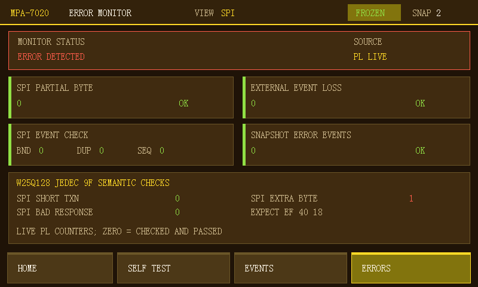

# A/B week-two update into C: build and board evidence (2026-10-17)

## Release identity and scope

- Integration branch: `codex/ab-week2-new-board-test`, based on C commit
  `8830069` and merged with `origin/fpga_AB_2week_merge` at `41a3ce0`.
- The new A/B feature is SPI `0x9F` JEDEC semantic error counting. The C UI
  retains its verified frame-present logic while showing the new PL counters.
- UART, I2C and CAN wires may be physically attached, but they are **not**
  PL listeners in this image. `CAPABILITIES=0x1F` denotes five core/SPI
  features, not five protocols; only SPI may show `PL READY`.

## Offline gates

- Host C tests: `error_model`, `event_audit`, `event_view`, `pixel_scroll`,
  `spi_trace`, `stm32_fault_bridge`, `ui_counter_semantics` and
  `ui_protocol_select` passed. The bridge test links `mc_faults.c` and
  `mc_truth_log.c` from `stm32_f407/common`.
- Vivado 2018.3 `run_sim.tcl`: all five RTL simulations passed.
- Fresh isolated synthesis/implementation/HDF/BIT build: `BUILD_DONE`.
  DRC had zero errors; timing WNS `+2.165 ns`, WHS `+0.036 ns`, all specified
  constraints met.
- SDK BSP/application rebuild from that HDF/BIT: `PS_BUILD_DONE`, fresh ELF.
- Exact tested artifacts are copied to `Multi_protocol.sdk/platform_hw` as a
  matched BIT/HDF/init set. The JTAG operation was volatile; QSPI was not
  programmed.
- SHA-256: BIT `91D397B3B9151C3D6CA6E90066FFA2F185F20F2A82A6FC609944CF2F5841F303`,
  HDF `785BA0A7D9AB183665F54B34D031C3DDE59B8CA52CB2B931294D4AFA0190D74B`,
  `ps7_init.tcl` `47D35117FE590757D5F887986AE68B1E64F5CDCFC7EEB480825AF9543BF91399`,
  ELF `98C9D10EA5FBF5CCDC9A5FB44BD59156C7BF5B370A8E47B81DE692689332CE83`.

## Board observations

- Initial read-only JTAG access had `AP transaction error` and PL `DONE=0`.
  A low-speed (250 kHz) probe did not restore DAP. PL-only programming set
  `DONE=1`, but PS access still failed. Following a Zynq power cycle and a
  later target re-enumeration, the repository's PL+PS+ELF sequence completed.
  This sequence is evidence of recovery, **not** proof of the root cause.
- Full JTAG test read back `SYS_ID=4D505254`, `VERSION=00010005`,
  `CAPABILITIES=0000001F`, `SCRATCH=A5A55A5A`; `ZYNQ_JTAG_BOARD_TEST_DONE`.
  The screen showed the current UI, as observed by the user.
- STM32 console was identified as COM4 at 115200 8N1. `spi probe` observed
  `EF 40 18`; a subsequent `spi jedec 1` reported TX `9F000000`, RX
  `FFEF4018`, result 0. The first JEDEC test before the explicit probe
  returned -4 despite correct bytes, so the probe step is required for this
  currently running STM32 firmware state.
- FPGA normal transaction statistics: 1 START, 4 DATA, 1 END, all SPI fault
  counters 0, `SPI_ACCEPTANCE_PASS`.
- Isolated `fault run 1` (case 1092): 1 START, 2 DATA, 1 END,
  `short_transactions=1`, `extra_bytes=0`, `response_mismatches=0`.
- Isolated `fault run 2` (case 1093): 1 START, 5 DATA, 1 END,
  `extra_bytes=1`, `short_transactions=0`, `response_mismatches=0`.
  `SPI_ACCEPTANCE_ATTENTION` is expected for deliberately injected faults.
- Both 800x480 RGB888 frame buffers were dumped through JTAG after case 1093.
  They both visibly show `ERROR DETECTED`, `SOURCE PL LIVE`,
  `SPI EXTRA BYTE 1`, and zero for the other three SPI semantic/partial-byte
  counters. This is LCD framebuffer evidence in addition to AXI evidence.

  
- Keep COM4 open across counter clear and injection: opening/closing the
  serial connection separately allowed other startup traffic into one early
  measurement window. The final two fault cases were each measured after
  clearing counters with COM4 already open.

## Not yet verified

- This run has not established UART, I2C or CAN PL monitoring despite the
  user's wiring. Their UI status must remain `NOT WIRED`/`OFFLINE`.
- The live `SPI BAD RESPONSE` counter has an RTL fault test and normal-board
  no-false-positive test, but no real bad-MISO injection in this run.
- Touch responsiveness and other protocol pages were not re-accepted in this
  run; the JTAG framebuffer readback establishes the error page pixels only.
