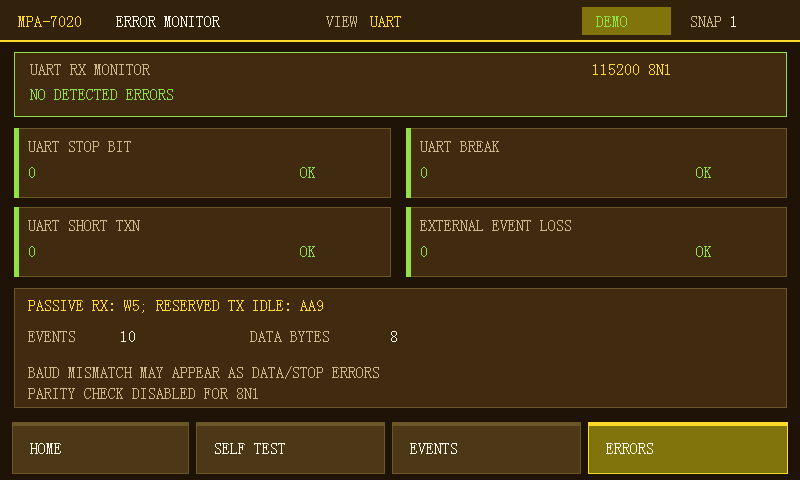
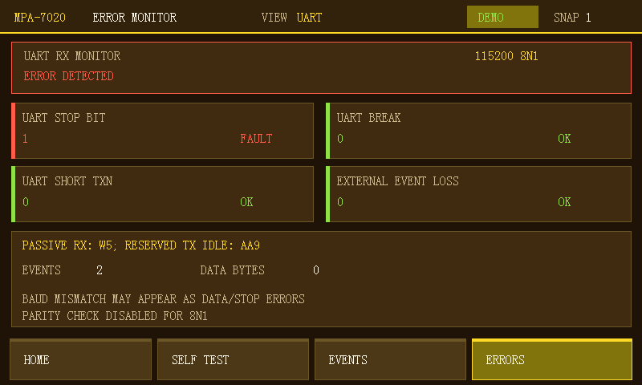

# UART merge and board retest, 2026-10-18

## Scope and source

- Integrated `origin/fpga_uart` commit `a6aba2f` into the isolated C test
  branch `codex/ab-week2-new-board-test`; preserved C's VDMA dirty-region
  cache flush and the SPI semantic/UI integration.
- The user had power-cycled the board. STM32 control serial re-enumerated as
  CH340K COM5 (115200 8N1); COM10 is a different CH9102 port.
- Tested wiring is STM32 USART3 TX PD8 to AC820 FPGA UART_RX W5 with common
  ground. FPGA AA9 remains idle-high and does **not** transmit UART echo.

## Build and release identity

- Vivado 2018.3: six RTL regressions passed, including UART normal 8N1,
  bad-stop, Break, short transaction and ready/valid backpressure.
- Fresh isolated implementation under `_validation_build/uart_merge` passed
  DRC with zero errors (two VDMA BRAM WRITE_FIRST advisories). Routed setup
  WNS `+1.158 ns`; hold WHS `+0.036 ns`; TNS and THS zero.
- SDK 2018.3 rebuilt `platform_app.elf` from the new HDF and merged PS source.
  `PS_BUILD_DONE` and `ZYNQ_JTAG_PREFLIGHT_DONE` were both observed.
- SHA-256 of the tested, matched artifacts:
  - BIT `3F23632A40125750DC0D08CEB6165646BCE12B6DCDA5DEBE8219C317ACBF3066`
  - HDF `2871B20CA74E55A97B05189EFE9F503795ABEABFC552648544DE47C2AE55235F`
  - `ps7_init.tcl` `47D35117FE590757D5F887986AE68B1E64F5CDCFC7EEB480825AF9543BF91399`
  - Final ELF `C67FDC4F30716E4F69ADD31DCFDA1C787E5DC56DECC1464F0392FD6ED5EC010E`
- The BIT/HDF pair is copied to tracked `Multi_protocol.sdk/platform_hw`.
  The tested ELF remains in `_validation_build/uart_merge/SDK/platform_app/Debug`.

## Real-board observations

- The repository JTAG script returned `ZYNQ_JTAG_BOARD_TEST_DONE`: PS target
  present, PL configured, AXI SYS_ID `0x4D505254`, VERSION `0x00010006`,
  CAPABILITIES `0x0000003F`, SCRATCH `0xA5A55A5A`, CPU resumed.
- Initial UART Break count was 1 after startup, before a controlled test.
  Each case below held COM5 open and cleared PL UART counters before sending
  one command, so startup activity is excluded from each measurement.
- `uart loop 1`: PL `EVENTS=10`, `DATA=8`, bad stop/Break/short/dropped all 0;
  `UART_ACCEPTANCE_PASS`. STM32 reported echo timeout (`-3`), expected because
  FPGA TX is deliberately disabled. This is passive RX acceptance, **not**
  bidirectional UART loopback acceptance.
- `fault run 4` / case 2091: STM32 reported success; PL `BAD_STOP=1`, all
  other UART faults and dropped=0.
- `fault run 7` / case 2094: STM32 reported success; PL `EVENTS=5`, `DATA=3`,
  `SHORT_TRANSACTION=1`, other UART faults and dropped=0.
- `fault run 5` / case 2092: STM32 reported success; PL `BREAK=1`, other UART
  faults and dropped=0.
- During the first display check, the error counter updated but Events/Data
  Bytes stayed at the preceding normal transaction's 10/8. The cause was
  `platform_ui_update_counters()` omitting UART fields from its requested
  status copy. This was fixed in PS software, rebuilt to the final ELF above,
  and re-downloaded by the matched JTAG script.
- The user again selected UART then ERRORS. Both 800x480 RGB888 framebuffers
  were read back over JTAG and were byte-identical. Normal traffic displayed
  `EVENTS 10 / DATA BYTES 8`; clearing PL counters changed the same page to
  `0 / 0`; case 2091 then displayed `UART STOP BIT 1 / FAULT` and `2 / 0`,
  exactly matching the PL counters. Break, Short and External Event Loss were
  all 0. The page also labels the RX-only W5/AA9 arrangement.

  

  

- SPI regression on the same UART bitstream: `spi probe` read `EF 40 18`;
  after clearing SPI counters, `spi jedec 1` passed with 1 START, 4 DATA,
  1 END, 6 events, and zero faults/drops (`SPI_ACCEPTANCE_PASS`).

## Remaining boundaries

- JTAG download was volatile; QSPI boot was not changed or cold-boot tested.
- UART is passive receive-only. Implementing AA9 TX/echo requires a separate
  design and board acceptance; do not label the STM32 loopback result PASS.
- I2C and CAN FPGA listeners are not included in this BIT, even if their
  physical wires are present. Their UI state must remain not-ready.
- Other UART fault modes (e.g. baud offset) and long-run throughput were not
  re-accepted in this board session.
