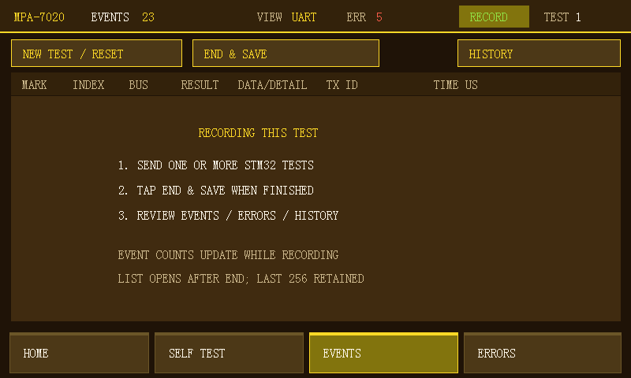
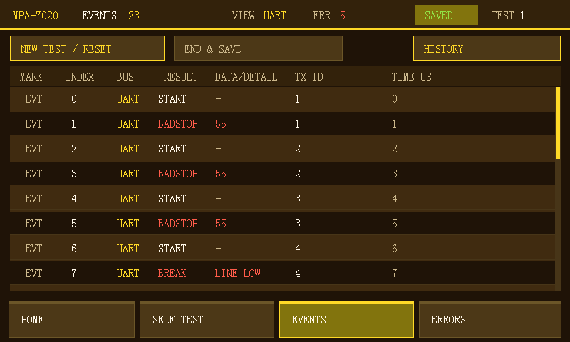
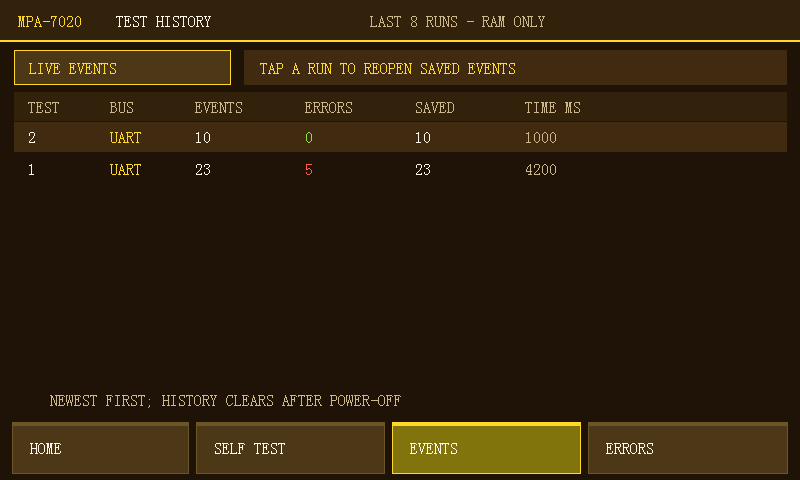
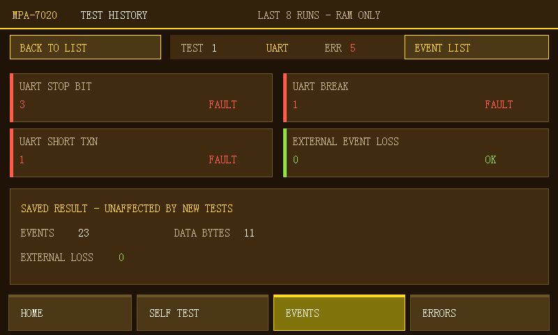

# 2026-10-20 测试轮次与历史记录离线验收

本记录仅代表离线结果。用户在本轮明确回复板子暂时不在，故没有执行上板下载、真实串口发包、LCD 实物观察或触摸手感验收。以下页面图片来自生产绘制代码运行在主机帧缓冲中的测试夹具，并非板子截图。

## 问题与修改

原 EVENTS 只显示一次触发后冻结的快照，冻结后发送的事件不再进入列表。UART 坏停止位、Break、短事务不一定满足原先的“第五字节触发”规则。错误统计又独立累计，造成“计数增加但没看到事件”和“下一次还保留旧错误”的体验。

新流程：NEW TEST / RESET → 发送一笔或多笔测试 → END & SAVE → 查看本次 EVENTS/ERRORS → HISTORY 回看过去测试。记录期间不依赖协议触发；停止时冻结数据和统计，新的测试清零自己的错误。保存最近 8 轮，包含每轮最多 256 条事件和独立错误模型。容量不足显示 TAIL256，总事件数不被保留条数替代。无快照、空测试和保存失败有不同状态。

事件列表显示 BADSTOP、BREAK、SHORT、EXTRA、BAD ID 等可读标签，DATA/DETAIL 展示字节或故障原因，TIME US 显示相对保留列表首条事件的时间。历史条目可切换事件列表和该轮错误详情；后续测试不会改写它。UART HOME 补上解码帧示意图，仍不具备电气逐位采样证据。

## 两轮离线检查

第一轮：增加手动冻结、协议过滤、空快照与历史深拷贝，六项 RTL 仿真通过。生产主循环的实际 begin_test/end_test 在模拟寄存器上运行，验证第一轮错误 4 保存后，第二轮开始归零并保持旧记录；正常、空测试、重开测试和 600 总事件/256 保留条目均通过。

第二轮：收紧 END 边界，协议计数在手动模式下也只统计所选协议的记录窗口。RTL 进一步验证 END 后继续输入错误不改变已结束统计，下一轮计数为零；六项回归再次全部通过。最终主机检查以 `-std=c99 -Wall -Wextra -Wpedantic -Werror` 编译，返回 `SESSION_CHECKS_PASS`：

- test_history：8 轮容量、最旧覆盖、历史副本、UART/SPI 错误标签与缺 START 时不误判。
- session_lifecycle：直接运行生产 begin/end 逻辑，验证 4→0、旧事件独立、空轮次、256 条保留、重开自动保存、保存失败可见。
- manual_capture：直接运行生产快照读取代码，验证能力检查、协议 ARM、无触发标记、空快照和读取中 ID 变化时拒绝缓存。
- ui_protocol_select、spi_trace、event_audit、error_model、event_view、pixel_scroll、ui_counter_semantics：既有相关回归通过。
- ui_session_preview：运行实际绘制/触控函数，验证 NEW TEST、END、HISTORY 命中、旧历史打开、错误详情切换与像素滚动。

复现主机测试：

```powershell
powershell -NoProfile -ExecutionPolicy Bypass -File software/tests/run_session_checks.ps1
```

RTL 使用 Vivado 2018.3 的 `fpga/build/run_sim.tcl`，测试包括 snapshot、仲裁器、AXI/core、SPI monitor、SPI snapshot path、UART monitor。最终日志有六项 PASS 和 SIMULATION_COMPLETED，而非仅以进程返回码判定。

## 最终构建

Vivado 2018.3 完整综合、布局布线和 BIT/HDF 导出通过，标记 BUILD_DONE。

| 项目 | 最终结果 |
|---|---:|
| WNS / TNS | +0.347 ns / 0 |
| WHS / THS | +0.036 ns / 0 |
| DRC errors / critical warnings | 0 / 0 |
| DRC advisory | 2 项既有 VDMA BRAM WRITE_FIRST 提示 |
| LUT | 5294 / 53200 |
| FF | 8536 / 106400 |
| BRAM tiles | 5.5 / 140 |
| 最终 ELF text / data / bss | 126356 / 2104 / 68624 bytes |

最终新 HDF 对应 BSP 已重新生成，PS_BUILD_DONE 后，对最后一处页面背景样式用 SDK make main-build 重新编译并返回 FINAL_SESSION_ELF_BUILD_DONE。所有候选文件精确哈希在 `releases/session-candidate-20261020/manifest.json`。四文件哈希检查和路径预检已通过 ZYNQ_JTAG_PREFLIGHT_DONE；这不等于上板通过。

## 离线页面预览

记录阶段有操作说明和实时计数：



完成后，同一轮的多个错误都可在列表中查看：



绘图夹具第一轮含 5 个错误、23 条事件；第二轮正常，0 错误、10 条事件。历史同时保留两轮：



第二轮为零之后，仍可打开第一轮的错误详情：



## 实板待验

板子接回后，使用根目录 04_Program_Session_Candidate.cmd。先确认 VERSION=0x00010007、CAPABILITIES=0x7F 和正常页面，然后验收连续两轮、重复 UART 故障、历史事件/错误不变、SPI 回归、超过 256 条的覆盖标记、UART 帧图和触摸切页/滚动。未完成前保持候选状态，不替换 03 入口的已测版，不写 QSPI。
