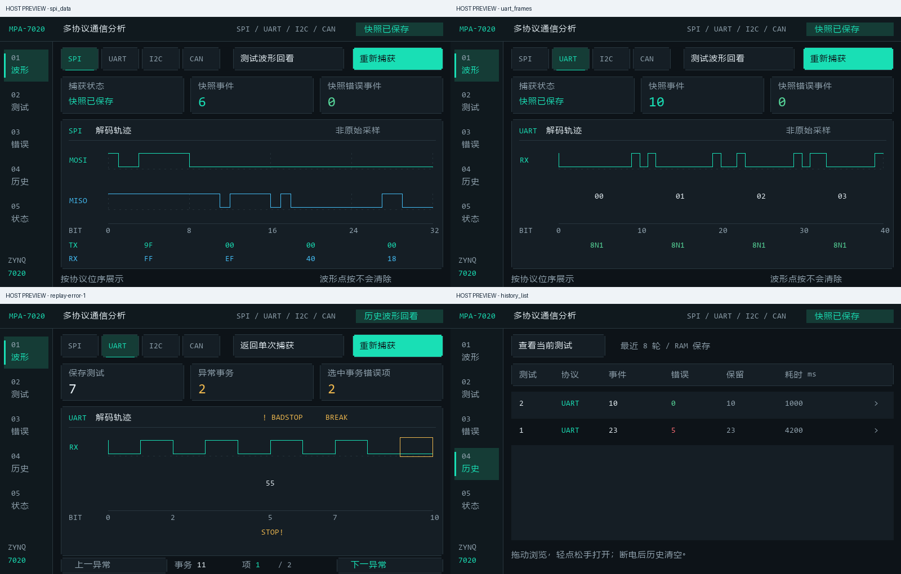

# 最新源码迁移至 Vivado / Vitis 2026.1（2026-11-02）

负责成员：member C。本轮独立分支：`migration/vivado-vitis-2026.1-latest-20261102`。

## 源码选择

重新枚举远端各分支尖端，以 FPGA 源码分支的提交时间确认最新版本为 `codex/ui-four-protocol-20261023`，`c5f44ff57ff1b551ba32569f4a2103a1b1cf35be`，2026-11-01 15:59:12 +08:00。它是 `fix/fpga_pl` / `14cafba` 的后继，包含中文工作台、保存回放和异常事务保留。仓库默认分支 `STM32_control_board` 属于另一侧工程。

本轮迁移以此完整基线开始，不把旧迁移分支覆盖到最新 UI / RTL 上。现有 `migration/vivado-vitis-2026.1` 和 PR #1 保留其原 10 月 24 日版本。

## 范围和适配

- 新源码位于 `migration_work/FPGAPrj_2026_1_latest_20261102`，新输出位于 `migration_build/2026.1-latest-20261102`。
- 重新应用 VTC 6.2 / inline constant / fixed include_bit XSA，以及 SDT 外设基址、中断 parent / wrapper、XilTimer 和 ARM32 xil_printf 格式适配。
- 保留最新生产 RTL 与 XDC、PS7 DDR/MIO/时钟和最新中文 UI、保存回放逻辑。
- Vitis 源文件导入扩展为 `.c/.h/.inc`；最新两个视图 include 文件必须与源码一起编译。
- 原基础 AXI 仿真的 ABI 预期落后于上游生产 RTL，本轮改为 VERSION=00010009 / CAPABILITIES=000003FF。首次失败日志保留在 `logs/simulation_first_attempt.log`。
- 统一运行入口增加 `error_retention_tb`，分别保存九项日志并拒绝含 Fatal 的结果。

## 已完成的回归

- 9 项 RTL XSIM 通过。新增测试包含四协议各 1000 事务、第 500 笔异常、存满保留、缺 END、I2C busy INFO、SPI 长度语义和原模式回归。
- 16 项基础宿主检查、保存回放检查，以及生产 UI 渲染/触摸动作回归通过。
- 中文工作台、波形保持、异常上一条/下一条、历史回放和实时缓存不变性均由对应宿主回归覆盖。

| 构建 / 检查 | 本轮结果 |
|---|---|
| Vivado | 2026.1 build 6511674，综合 / 实现 / BIT / fixed include_bit XSA 完成 |
| 内部 setup / hold | WNS=0.738 ns，WHS=0.026 ns，TNS=THS=0 |
| 脉宽 | WPWS=3.870 ns，无失败端点 |
| CDC | 已报告 87 个端点均 safe，unsafe/unknown=0 |
| Bus skew | 三组满足，最小余量 9.301 ns |
| DRC | 仅 2 项 VDMA BRAM WRITE_FIRST advisory，无 Error / Critical Warning |
| 资源 | LUT=6,666，寄存器=10,404，BRAM=5.5，DSP=0 |
| Vitis | 2026.1 build 6497934，平台/BSP、Hello World、业务 ELF、FSBL 构建成功 |
| PS7 参数 | 与最新基线 BD 归一化后完全一致 |
| 应用内存 | ELF LOAD 段不覆盖双帧缓冲，heap / stack 各 64 KiB |
| 编译源码 | `.c/.h/.inc` 与导入 Vitis 工作区的副本逐文件核对 |
| 外部约束 | 保留 20 项 TIMING-18，LCD/CAN 输出预算未完成，不据内部时序宣称接口验收完成 |

应用 ELF 的 text/data/bss 分别为 239,710 / 3,440 / 198,320 字节。完整时序、配套文件 SHA256 和保护检查见同轮 `verification.json`、`candidate/manifest.json` 和工具日志。原厂生成代码告警保留在日志中，未改写安装目录。

## 本轮没有实板验收

现场只枚举到 COM1，没有 FPGA JTAG 或 STM32 / PS USB 串口。本轮没有执行下载、触摸或四协议实流量测试。10 月 24 日用户确认的触摸、切页和协议结果，以及最新基线原 2018.3 的实板证据，均作为各自版本的历史记录保留。

请连接硬件后按 [本轮迁移说明](../../README_MIGRATION_2026_1.md) 交叉验证。新的正式 TESTS 只存异常事务，正常 600 事件计数与保存明细数量应分别对账；不要沿用旧环形尾部验收标准。

LCD/CAN 外部时序预算、2026.1 hw_server 的本机枚举兼容性、长时间稳定性及 SD 启动仍需现场验证。本次不写 QSPI / SD。
